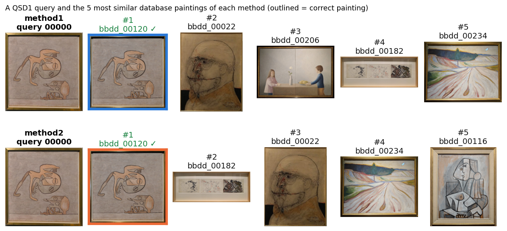

# Content-Based Image Retrieval (Team 7)

Retrieval of museum paintings with global 1D colour histograms. Each query photo is described with the
histograms of three colour spaces, compared with every painting of the database (BBDD), and the 10 most similar
paintings are returned. This branch contains only the code needed to reproduce our two submitted methods.



## Submitted methods

| Method | Descriptor (global 1D histograms, 32 bins per channel) | Similarity | QSD1 mAP@1 | QSD1 mAP@5 |
| --- | --- | --- | ---: | ---: |
| `method1` | HSV + Lab + rgb, gray-world, contrast stretch of V and L, brightness weight 0.25 | Hellinger kernel | 0.9000 | 0.9500 |
| `method2` | HSV + YCbCr + rgb, gray-world, contrast stretch of V and Y, brightness weight 1 | chi-square | 0.9000 | 0.9167 |

Both methods use the same pipeline, applied identically to the database and to the queries:

1. **Gray-world:** the B, G and R channels are scaled to the same mean (removes the colour cast of the lights).
2. **Colour conversion** to the three colour spaces of the method.
3. **Contrast stretch** of the brightness channel of each space (V in HSV, L in Lab, Y in YCbCr): its 1st and 99th
   percentiles are mapped to the full range. Normalised rgb has no brightness channel.
4. **1D histogram per channel** (32 bins), each normalised to sum 1; the brightness histograms are multiplied by
   the brightness weight.
5. **Concatenation** of the 9 histograms into a 288-value descriptor, normalised to sum 1.
6. **Ranking** of the 287 BBDD paintings with the method's similarity; the top 10 are kept.


## Requirements

Python 3.10 or newer with NumPy and OpenCV. Any of these three ways works:

```bash
# A) uv
uv sync                                   # then prefix the commands below with "uv run"

# B) venv + pip
python -m venv .venv
source .venv/bin/activate                 # macOS / Linux
.venv\Scripts\activate                    # Windows
pip install numpy opencv-python           # or: pip install .

# C) conda
conda create -n cbir python=3.11
conda activate cbir
pip install numpy opencv-python
```

## Data

The dataset is not included. Place it in a `data/` folder next to `main.py` (or pass other folders with
`--corpus_data` and `--query_data`):

```text
data/
├── BBDD/          # bbdd_00000.jpg ... bbdd_00286.jpg
├── qsd1_w1/       # 00000.jpg ... 00029.jpg and gt_corresps.pkl
└── qst1_w1/       # 00000.jpg ... 00029.jpg
```

## Reproduce our results

Run from the repository root.

**QSD1 (development set, with ground truth):**

```bash
python main.py --method method1 --top-k-retrieval 10 --top-k-evaluation 1    # mAP@1 = 0.9000
python main.py --method method1 --top-k-retrieval 10 --top-k-evaluation 5    # mAP@5 = 0.9500
python main.py --method method2 --top-k-retrieval 10 --top-k-evaluation 1    # mAP@1 = 0.9000
python main.py --method method2 --top-k-retrieval 10 --top-k-evaluation 5    # mAP@5 = 0.9167
```

**QST1 (blind test, no ground truth): the submitted files**

```bash
python main.py --method method1 --query_data data/qst1_w1 --output results/week1/QST1/method1/result.pkl
python main.py --method method2 --query_data data/qst1_w1 --output results/week1/QST1/method2/result.pkl
```

These two commands produce our submitted `result.pkl` files (the output folders are created automatically).
Each run takes a few minutes (most of it reading the 287 database images).

## Output format

Each `result.pkl` is a pickled Python `list` with one `list` per query, in query file order (00000.jpg, 00001.jpg,
...). Each inner list holds the 10 most similar BBDD ids as Python `int`, most similar first, with no repeated ids
(id 7 means `bbdd_00007.jpg`). The format is validated before the file is written (`src/submission.py`).

## Other options

`main.py` also runs custom configurations, for example the team baseline:

```bash
python main.py --color-spaces HSV Lab --bins 16 --similarity l1 --top-k-retrieval 10 --top-k-evaluation 5
```

| Argument | Default | Description |
| --- | --- | --- |
| `--method` | None | `method1` or `method2`; sets all the descriptor options below. |
| `--corpus_data` | `data/BBDD/` | Folder with the database images. |
| `--query_data` | `data/qsd1_w1/` | Folder with the query images (and `gt_corresps.pkl` for evaluation). |
| `--color-spaces` | `HSV Lab` | `RGB`, `HSV`, `HLS`, `Lab`, `Luv`, `YCbCr`, `rgb`, `Opponent`, `Gray`. |
| `--bins` | `16` | Histogram bins per channel. |
| `--gray-world` | off | Gray-world colour correction. |
| `--contrast-stretch` | off | Stretch the brightness channel to its 1st–99th percentiles. |
| `--luminance-weight` | `1` | Weight of the brightness histograms. |
| `--similarity` | `l1` | `euclidean`, `l1`, `chi2`, `hist_intersection`, `hellinger_kernel`, `cosine_similarity`, `correlation`. |
| `--top-k-retrieval` | no limit | Images retrieved per query (`--output` uses 10). |
| `--top-k-evaluation` | no limit | Results used for mAP (use 1 or 5). |
| `--output` | none | Write the validated Top-10 `result.pkl`. |

Evaluation runs only when the query folder contains `gt_corresps.pkl`, so QST1 is never evaluated.

## Code

```text
main.py                 # command-line entry point; METHODS holds the two submitted configurations
src/
├── data_loading.py     # image loading (sorted by file name) and ground truth
├── descriptors.py      # colour conversions, gray-world, contrast stretch, 1D histogram descriptors
├── similarities.py     # distance and similarity measures
├── retrieval.py        # ranking and top-k retrieval
├── evaluate.py         # mAP@k (adapted from https://github.com/benhamner/Metrics)
└── submission.py       # Top-10 validation and pickle export
assets/qsd1_example.png # example figure of this README
```
