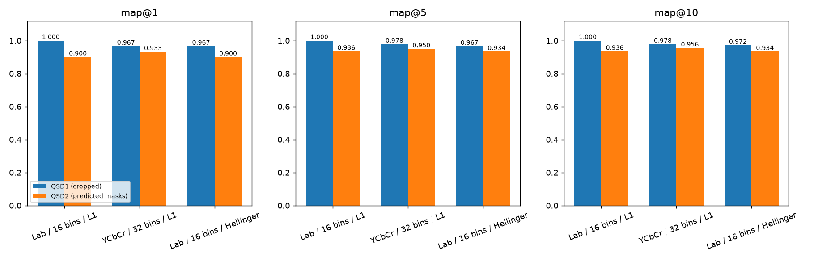

# Museum painting retrieval — Group 7

Color-based painting retrieval for MCV C1, Weeks 1 and 2. The command-line program
runs inference, evaluation and submission export using only the source files
in this delivery. Development notebooks are not required or included.

## Install

Python 3.10 or newer is required.

```bash
python -m venv .venv
source .venv/bin/activate
python -m pip install -e .
```

Inference and evaluation require only NumPy and OpenCV.
The equivalent installed command is `cbir` instead of `python main.py`.

## Data

The dataset is not included in Git. The default layout is:

```text
data/
├── BBDD/          # bbdd_00000.jpg, ...
├── qsd1_w1/       # development queries and gt_corresps.pkl
├── qsd1_w2/       # cropped development queries and gt_corresps.pkl
├── qsd2_w2/       # development queries, binary PNG masks and gt_corresps.pkl
├── qst1_w1/       # Week 1 test queries
├── qst1_w2/       # cropped Week 2 test queries
└── qst2_w2/       # Week 2 test queries with background
```

Use `--corpus_data /path/to/BBDD` and `--query_data /path/to/queries` for a different
layout.

## Run the selected methods

### Week 2 delivery

QS1 images are already cropped: do not segment them. QS2 images contain background:
segment them before computing the descriptor. The mode is explicit and is never
guessed from the directory name.

```bash
python main.py --method method1 --background none --query_data data/qst1_w2 --output results/week2/QST1/method1/result.pkl
python main.py --method method1 --background remove --query_data data/qst2_w2 --output results/week2/QST2/method1/result.pkl
python main.py --method method2 --background none --query_data data/qst1_w2 --output results/week2/QST1/method2/result.pkl
python main.py --method method2 --background remove --query_data data/qst2_w2 --output results/week2/QST2/method2/result.pkl
```

We submit **two methods**, each with identical retrieval parameters across QSD1,
QSD2, QST1 and QST2. Only background removal depends on the input mode.

| Delivery | CLI preset | Descriptor | Distance | Luminance weight | Dimension |
| --- | --- | --- | --- | --- | --- |
| `method1` | `method1` | HSV + Lab + normalized rgb, 4×4, 16 bins | L1 | 0.25 | 2,304 |
| `method2` | `method2` | HSV + YCbCr + normalized rgb, 4×4, 32 bins | L1 | 1.0 | 4,608 |

Both use gray-world correction and percentile contrast stretching in descriptor
preprocessing. Both use the same segmentation for QS2, producing identical masks.
The historical comparison is available as `--method week2_hellinger` (Hellinger),
but is **not** a delivery method. Original Week 1 presets are explicitly named
`week1_method1` and `week1_method2` to avoid confusing them with the two Week 2
submissions. All descriptor families required by Task 1 (2D, 3D, blocks and
pyramids) remain implemented in `src/descriptors.py`.

Segmentation uses standard Lab color distance, channel-wise border median, L2,
lightness weight 0.75, a border covering 4% of the shorter side, distance threshold
18, 5×5 closing, hole filling and the largest component. Images are not resized.
These defaults remain configurable through `remove_background`. Gray-world is
used only in descriptor preprocessing, not in segmentation.

Each PKL contains a Python `list[list[int]]`: one row per query in sorted filename
order, with exactly ten distinct database IDs ordered from best to worst. QS2
masks are saved beside `result.pkl`, using each query's original stem and `.png`
extension. Masks retain the input dimensions and contain only uint8 values 0/255.
All predictions are validated before export, and the saved PKL is reopened and
checked. Empty or too-small masks count as failures in evaluation and prevent an
incomplete submission from being exported. The pipeline assumes one painting
per query.

Each test set has separate `method1/` and `method2/` directories. Test execution
requires no annotations. The four commands above recreate all delivery files.

### Week 1 compatibility

```bash
python main.py --method week1_method1 --query_data data/qst1_w1 --output results/week1/QST1/method1/result.pkl
python main.py --method week1_method2 --query_data data/qst1_w1 --output results/week1/QST1/method2/result.pkl
```

The original Week 1 preset parameters are unchanged; only their CLI names
now include the `week1_` prefix. Custom global histograms are also supported;
see `python main.py --help`.

### Development evaluation

```bash
python main.py --method method1 --background none --query_data data/qsd1_w2 --evaluate
python main.py --method method1 --background remove --query_data data/qsd2_w2 --evaluate
python main.py --method method2 --background none --query_data data/qsd1_w2 --evaluate
python main.py --method method2 --background remove --query_data data/qsd2_w2 --evaluate
python main.py --method week1_method1 --query_data data/qsd1_w1 --evaluate
```

`--evaluate` prints retrieval mAP@1/5/10 and available mask metrics. Without it,
inference does not read ground truth. The CLI writes only explicitly requested
submission artifacts; it does not create CSVs, figures or development reports.

## Repository layout

```text
main.py                       # CLI: arguments, inference, optional metrics, export
src/
  config.py                   # selected descriptor presets
  data_loading.py             # image and annotation loading
  segmentation.py             # final color-based mask prediction
  descriptors.py              # global, spatial and joint histograms
  similarities.py             # histogram comparisons
  retrieval.py                # database ranking
  pipeline.py                 # inference orchestration; no annotation reads or writes
  evaluate.py                 # segmentation and retrieval metrics
  submission.py               # validated Top-10 PKL and PNG export
README.md                     # installation, methods and evaluation commands
assets/                       # supporting figures and selection table
pyproject.toml                # dependencies and CLI installation
.gitignore                    # local data and generated environment exclusions
```

The root CLI delegates algorithms to `src`. Neither inference nor evaluation
requires notebooks, cached experiments, tests or precomputed results. Datasets
are supplied separately; `results/` is created when exporting predictions.
Any supplementary presentation assets in `assets/` are optional and are not
loaded by the code.

## Development results

| Task | Result |
| --- | --- |
| 1 — Descriptor families | Blocks and pyramids reach QSD1 mAP@5 1.0000; the submitted block descriptors have 2,304 and 4,608 values |
| 2 — Cropped retrieval | Method 1: 30/30, mAP@5 1.0000; method 2: 29/30, 0.9778; Week 1 best: 27/30, 0.9500 |
| 3–4 — Background removal | Mean precision 0.9646, recall 0.9833, F1 0.9733; minimum F1 0.9013; 0/30 below 0.90 |
| 5 — Full QS2 pipeline | Method 1: 27/30, mAP@5 and mAP@10 0.9361; method 2: 28/30, mAP@5 0.9500, mAP@10 0.9556 |
| 6 — Test delivery | Commands above export Top-10 PKL rankings and native-resolution QS2 PNG masks |

QSD2 retrieval with ground-truth masks gives mAP@5 0.9556 for method 1 and
0.9667 for method 2. It is a separate diagnostic, not the complete pipeline score.
All model choices used development images; these results are not an independent
estimate of unseen-image performance.

## Why these two methods?

We rank the three Week 2 finalists by equal-weight mean mAP@5 across QSD1 and
QSD2, with worst-set mAP@5, mean mAP@1 and descriptor size as tie-breakers.
QSD2 uses predicted masks for selection. The two highest-ranked finalists are
submitted; neither changes its descriptor between datasets.

| Finalist (4×4 blocks) | QSD1 top-1 | QSD1 mAP@5 | QSD2 top-1 | QSD2 mAP@5 | Mean mAP@5 | Delivery |
| --- | --- | --- | --- | --- | --- | --- |
| HSV + Lab + rgb, 16 bins, L1 | 30/30 | 1.0000 | 27/30 | 0.9361 | 0.9681 | Method 1 |
| HSV + YCbCr + rgb, 32 bins, L1 | 29/30 | 0.9778 | 28/30 | 0.9500 | 0.9639 | Method 2 |
| HSV + Lab + rgb, 16 bins, Hellinger | 29/30 | 0.9667 | 27/30 | 0.9344 | 0.9506 | Not submitted |

Method 1 has better average mAP@5 and a smaller descriptor; method 2 performs
better on QSD2. Both achieve 57/60 top-1 matches across development. The same
segmentation satisfies the per-image F1 floor for both. These rankings concern
the tested finalists, not a claim of global optimality. Hellinger remains part
of the original Week 1 baseline, which uses global histograms and 32 bins.



[Selection metrics](assets/unified_selection.csv) contain full-precision scores
and the mapping to delivery methods. Test predictions are generated only after
freezing both configurations; no test accuracy is used for selection.
