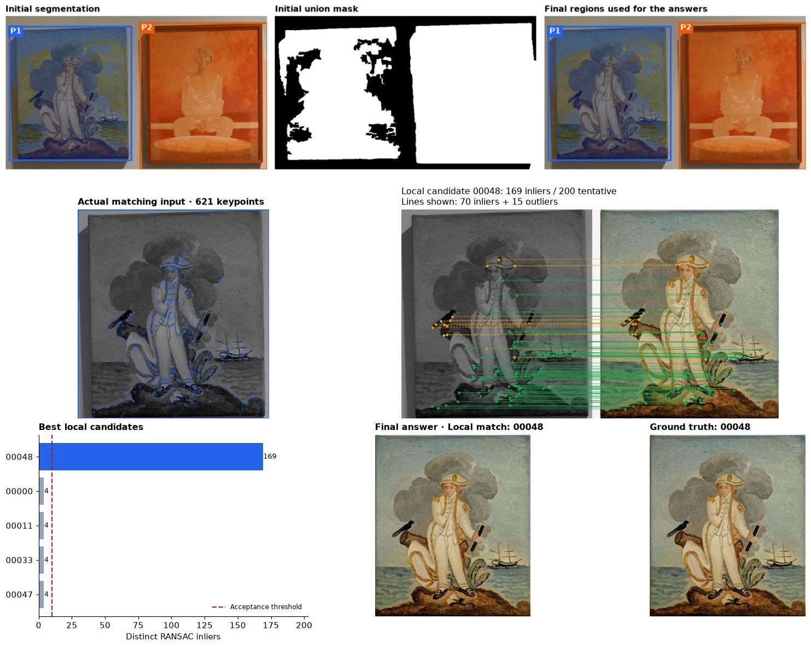

# Week 4 — keypoints, local descriptors and unknown paintings

Team 7 · MCV C1. Final presentation slides: [Google Slides](https://docs.google.com/presentation/d/1dlodYrXETs0cELaLBbFmOQlS5Bq-oSE3WiPBOOjOVC8/edit?usp=sharing).

<p align="center"></p>

The code is the final Team 7 pipeline (Weeks 1–4 in one tree: `src/` and `main.py`). Run everything from this folder with `pip install -r requirements.txt`.

## Tasks

1. Detect keypoints and compute local descriptors on museum and query images.
2. (I) Find tentative matches with suitable similarity measures, verify them geometrically and rank the museum per painting.
   (II) Answer `[-1]` for paintings that are not in the museum.
3. Compare with the previous (Week 3) global-descriptor system.
4. Submit QST1-W4 (photos with up to three paintings, noise and colour changes).

## Submitted method (method1)

1. **Regions:** wall-plane background removal, components filtered by area and confident foreground, up to three
   paintings, refined with quadrilaterals; reading order (rows top to bottom, left to right within a row).
   Before the three-painting limit, regions smaller than 10 % of the photo's largest region are dropped
   (`MIN_REGION_FRACTION = 0.10` in `src/config.py`), see Region filter.
2. **Features (Task 1):** each painting crop filtered if noisy, grey, DoG keypoints (at most 1000, 900 px) with
   SIFT descriptors (`src/keypoints.py`, `src/local_descriptors.py`).
3. **Matching (Task 2-I):** SIFT compared as RootSIFT (Hellinger), Lowe ratio 0.75, cross-check, RANSAC
   homography (5 px); score = inliers counted once per distinct museum keypoint (`src/matching.py`).
   Extra known paintings inside a merged region are recovered from the unexplained keypoints (≥ 10 inliers).
4. **Unknowns (Task 2-II):** accept a local score ≥ 10; below it, accept the Week 3 colour + texture descriptor
   only if its best / second distance ratio is < 0.85; otherwise `[-1]` (`src/unknowns.py`).

Settings: `LocalMethod` in `src/local_pipeline.py`, with its values in `src/config.py` (`LOCAL_MATCH`,
`UNKNOWN_THRESHOLD`, `RECOVERY_MIN_INLIERS`, `GLOBAL_RATIO`, `MIN_REGION_FRACTION`). 

Task 1 study was run with OpenCV 4.11; the delivered pipeline uses 4.13.0.92.
The study also kept at most 800 keypoints per image and verified with a 3 px RANSAC threshold
(metadata.json); the pipeline uses 1000 keypoints and 5 px.

## Results (QSD1-W4: 30 photos, 39 paintings, 10 unknown)

| Method | Set | top-1 | mAP@1 | mAP@5 | Unknown precision / recall / F1 | Blind test (QST1-W4) |
| --- | --- | ---: | ---: | ---: | --- | --- |
| Week 4 method1 | QSD1-W4 | 38/39 | 0.974 | 0.974 | 0.909 / 1.000 / 0.952 | submitted: 30 photos, 39 paintings, 9 `[-1]`; score not yet published |
| Week 4 method1 | QSD1-W4, known paintings only | 28/29 | 0.966 | 0.966 | – | – |
| Week 4 method1 | QSD2-W3 (39 paintings, all known) | 38/39 | 0.974 | 0.974 | – | – |

The thresholds (10, 0.85) were chosen on QSD1-W4, so its numbers are optimistic. The region filter was set from
QSD2-W3 00002 and checked on QSD1-W4, QSD2-W3, QSD1-W3 and QSD2-W2.

## Why this method

### Task 1: detectors and descriptors

Harris, Harris-Laplace and DoG × SIFT, ORB and BRISK (9 combinations) on QSD1-W4 under a 90° rotation and a 65 % resize, and on 29 known query–museum pairs. DoG + SIFT has the highest mean match precision (0.948) and the most RANSAC inliers on known pairs (mean 129.4 against ≤ 78.8 for the other combinations, about 3 on unrelated controls).
Its cost is moderate: mean 77 ms detection + description per image, against 57 ms for Harris + SIFT and 136 ms for
Harris-Laplace + SIFT; the nine combinations range from 18 ms (Harris + BRISK) to 136 ms.

The means above are computed from the CSVs over all rows of each combination.

### Task 2 (I): metric comparison and ablation

Known paintings only (QSD1-W4: 29 of 39; QSD2-W3: 39), an earlier local-only version of the method (before three
paintings, recovery and the global fallback). Best setting per descriptor and metric:

| Descriptor | Metric | Cross-check | Score | QSD1-W4 top-1 / mAP@1 | QSD2-W3 top-1 / mAP@1 | s/query (QSD1-W4 / QSD2-W3) |
| --- | --- | --- | --- | --- | --- | --- |
| SIFT | Hellinger (RootSIFT), ratio 0.75 | on | matches | 24/29 / 0.828 | 37/39 / 0.949 | 6.4 / 7.5 |
| SIFT | L2, ratio 0.7 | on | matches | 24/29 / 0.828 | 37/39 / 0.949 | 6.4 / 8.5 |
| SIFT | L1, ratio 0.7 | on | matches | 24/29 / 0.828 | 37/39 / 0.949 | 11.4 / 13.8 |
| BRISK | Hamming, ratio 0.7 | off | distinct inliers | 22/29 / 0.759 | 35/39 / 0.897 | 5.8 / 7.5 |
| ORB | Hamming, ratio 0.8 | on | matches | 13/29 / 0.448 | 21/39 / 0.538 | 3.9 / 4.9 |

Score "matches" counts tentative matches (no RANSAC). SIFT is clearly best; the three SIFT metrics tie on mAP@1 and
Hellinger has the best QSD2-W3 mAP@5 (0.962, with score = matches) at the lowest time. The submitted setting (SIFT,
Hellinger, ratio 0.75, cross-check, RANSAC, distinct inliers) gives 24/29, mAP@1 0.828, mAP@5 0.845, 8.5 s/query on QSD1-W4
and 37/39, mAP@1 0.949, mAP@5 0.949, 10.2 s/query on QSD2-W3. Ablation (SIFT + Hellinger, ratio 0.75), QSD1-W4 / QSD2-W3 mAP@1: ratio test only 0.793 / 0.923;
+ cross-check 0.828 / 0.949; + RANSAC inliers and + distinct inliers (chosen) unchanged at 0.828 / 0.949. RANSAC and distinct inliers are kept because the score is also the evidence for the
unknown decision (a geometric consensus, not a raw match count) and the distinct count stops degenerate
many-to-one homographies (a degenerate homography matched everything to a few museum keypoints).
A homography plausibility check was not kept: 0.655 / 0.769, because it rejects correct matches (museum images are
larger than the query crops).

### Task 2 (II): unknown paintings

- **Threshold-only study:** with only a local-score threshold, the unknown
  F1 on QSD1-W4 is maximal (0.909: precision 0.833, recall 1.000) for every threshold from 7 to 16. The threshold
  is set to **10**, inside that plateau.
- **Global fallback:** below the threshold, the Week 3 colour + texture answer is accepted only when its best /
  second distance ratio is **< 0.85**. With it, the final unknown precision / recall / F1 on QSD1-W4 is
  0.909 / 1.000 / 0.952. 0.85 is F1-optimal on QSD1-W4, tied with 0.90 (both give F1 0.952); it was kept for its larger margin to the nearest unknown painting, whose
  ratio is 0.913.
- **Robustness:** threshold 8–15 gives identical results on QSD1-W4, QSD1-W3 and QSD2-W3. The ratio is safe in
  about 0.80–0.91: 0.80 loses QSD1-W4 00016, whose ratio is 0.801, and the closest unknown painting has ratio 0.913.

### Task 3: comparison with Week 3

The Week 3 method (global colour + LBP + DCT + wavelet, up to two paintings, no `[-1]` answer) is perfect on its own
development sets (QSD1-W3 30/30, QSD2-W3 39/39, mAP@1 1.000). On QSD1-W4:

| Method | All 39 paintings: top-1 / mAP@1 / mAP@5 | 29 known paintings: top-1 / mAP@1 / mAP@5 | Unknown F1 |
| --- | --- | --- | --- |
| Week 3 method1 | 23/39 / 0.590 / 0.603 | 23/29 / 0.793 / 0.810 | 0 (never answers `[-1]`) |
| Week 4 method1 | 38/39 / 0.974 / 0.974 | 28/29 / 0.966 / 0.966 | 0.952 |

Local features fix most of the Week 3 errors on known paintings (23 → 28 of 29) and the unknown decision adds the
10 `[-1]` answers that a global descriptor cannot give. Week 4 keeps the Week 3 descriptor as the fallback when the
local evidence is weak.

### Region filter

Before the three-painting limit, regions smaller than 10 % of the photo's largest region are dropped
(`MIN_REGION_FRACTION` in `src/config.py`), because a spurious 161×65 region in QSD2-W3 00002 became an extra
`[-1]` (the smallest real painting in the dev sets is 20 % of the largest). On QSD2-W3 with the full Week 4
method, mAP@1 goes from 0.950 to 0.974 (39 regions).
## Reproduce

Delivery and development scores (run from this folder, datasets in `data/`):

```bash
python main.py evaluate --week 4 --set qsd1_w4        # Week 4 method1 on QSD1-W4 (table above)
python main.py evaluate --week 4 --set qsd2_w3        # Week 4 method1 on QSD2-W3
python main.py evaluate --week 3 --set qsd1_w4        # Task 3 baseline: the Week 3 method on QSD1-W4
python main.py predict --week 4                       # QST1-W4 -> weeks/week4/submission/QST1/method1/result.pkl (not tracked in git)
python main.py validate --week 4
```

`--threshold N` changes the local acceptance score (default 10); `--max-paintings` the painting limit (default 3).

## Limitations

- **Painting 128 is weak for local matching.** QSD1-W4 00008 is the only QSD1-W4 failure: the best local score is
  5, for a wrong painting, against 4 for painting 128; the global fallback ranks 128 first, but its ratio 0.939 is
  above 0.85, so the answer is not accepted.
- **Tuned on the development sets.** The local score 10 and global ratio 0.85 were chosen on QSD1-W4 and the
  region fraction 0.10 from QSD2-W3, so the development numbers are optimistic estimates of test accuracy.
- The Task 2 (I) comparison describes the earlier local-only method; it was not rerun with three paintings,
  recovery and the global fallback.
- The Task 1 study used OpenCV 4.11, at most 800 keypoints and a 3 px RANSAC threshold; the delivery uses
  4.13.0.92, 1000 keypoints and 5 px.

## Blind test

The QST1-W4 `result.pkl` (30 queries, 39 paintings, 9 answered `[-1]`) was delivered through the course Google Drive folder, not stored in this repository. The score is published by the course staff.
